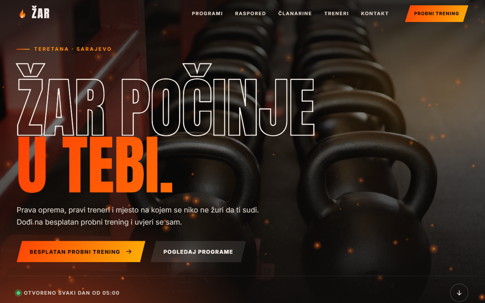
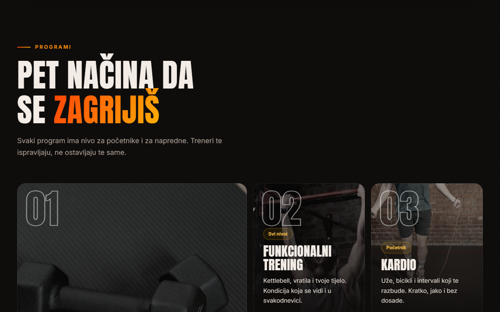
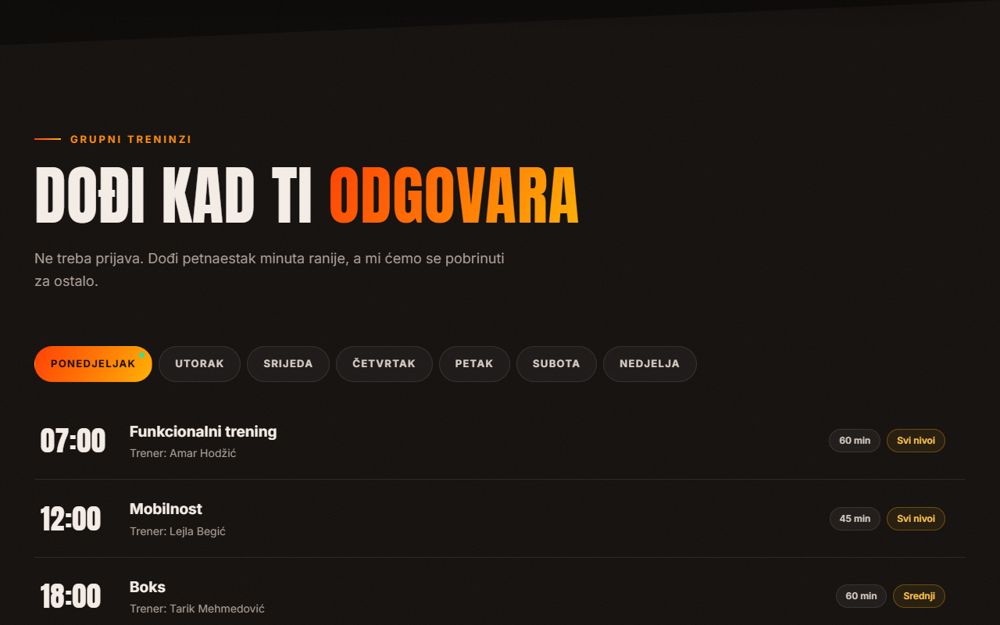
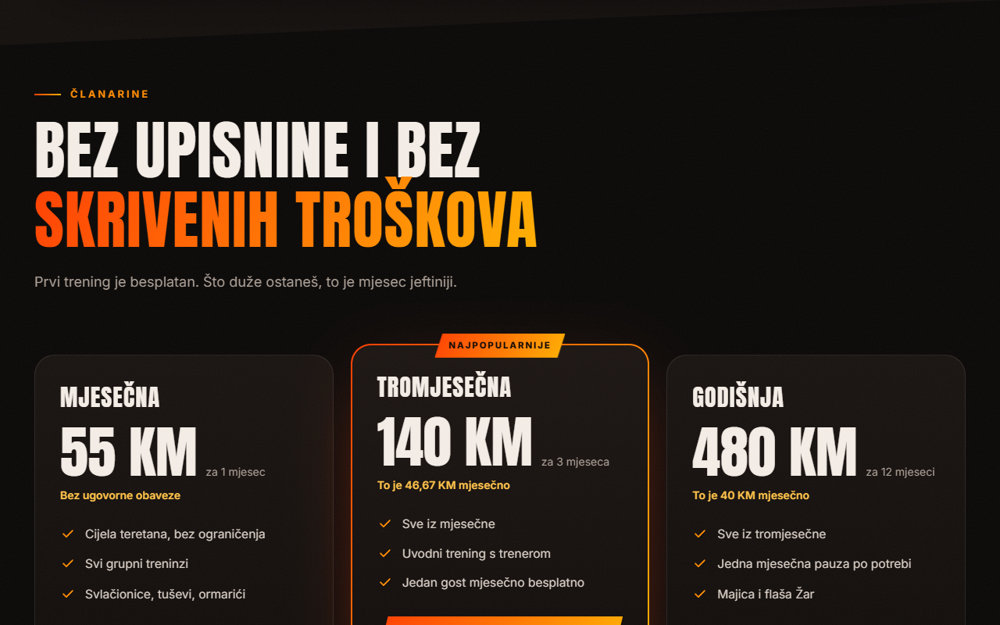
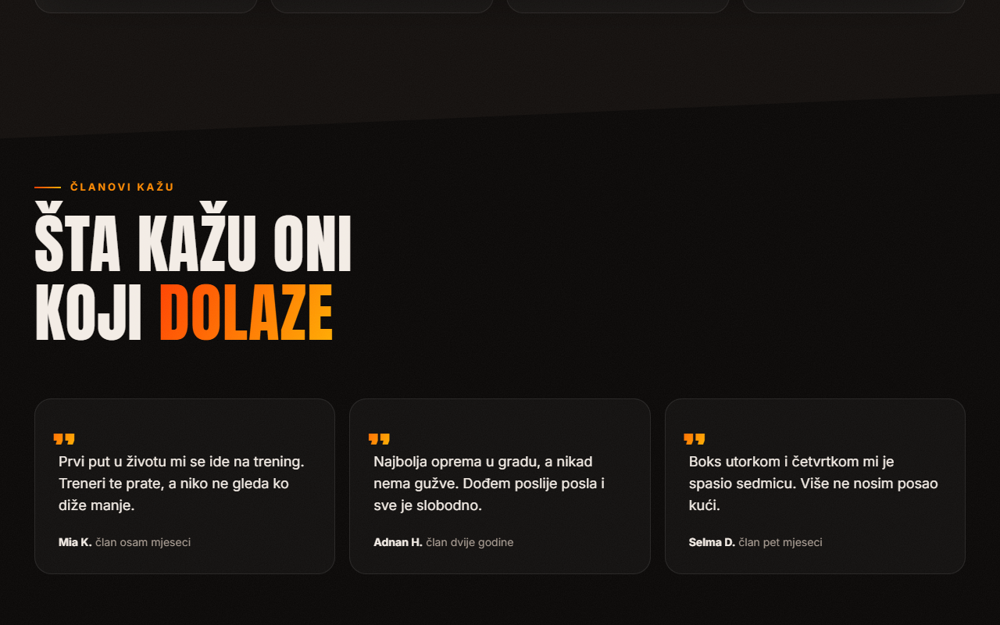
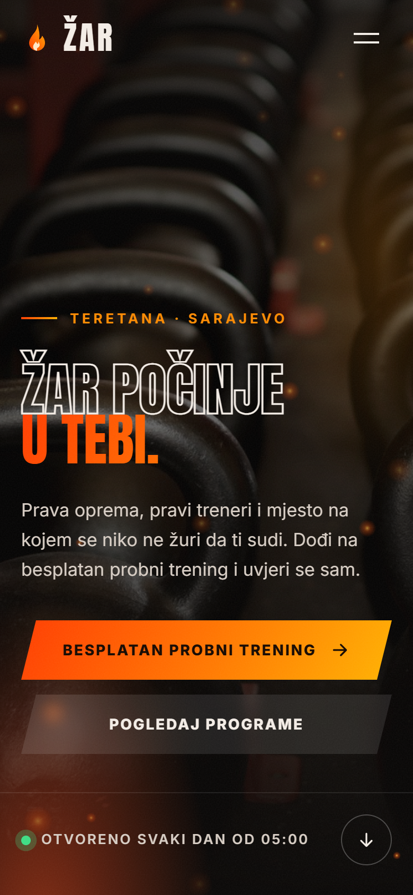
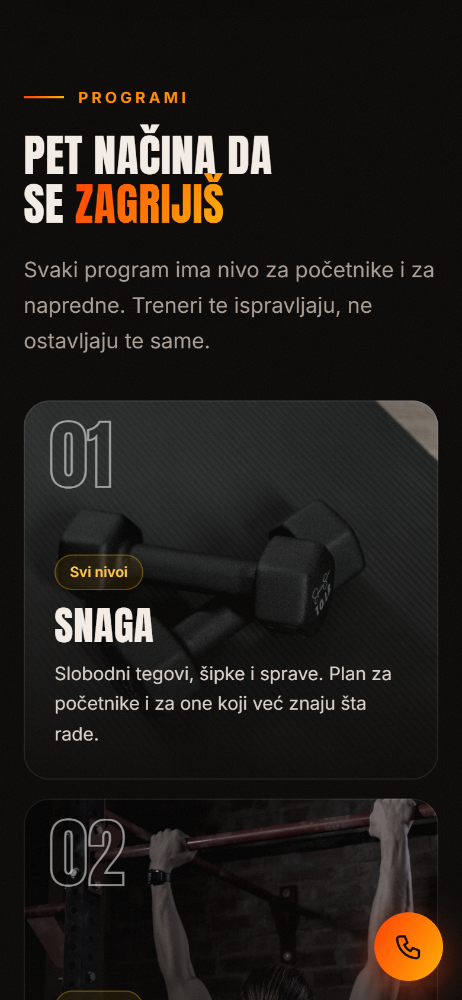

# Žar: gym website

[](https://github.com/Emir0404/ZarGym/actions/workflows/ci.yml)

A one-page promotional website for a (fictional) gym in Sarajevo, built with ASP.NET Core 10 Razor Pages. A dark "ember"
theme, sparks over the hero, numbers that count up, a schedule you browse by day, and a phone call as the one call to action.
No forms and no database: the page is meant to be fast, readable on a phone and impossible to break.

**Live demo:** https://zar-teretana-demo.puskicemir.workers.dev (a static export served by Cloudflare Workers).
The site is in Bosnian; the code comments and this documentation are in English.

## Screenshots

 

 

  

## What is on the page

- **Hero** with an orange-to-yellow outlined headline and sparks drawn on a canvas (they pause when the hero is off screen).
- **Numbers** that count up when they come into view, **programs** in a grid, **"why us"**, the **space**.
- **Schedule** as cards per day of the week, starting on Monday, times in 24-hour format.
- **Memberships** with the price per month, **trainers**, **testimonials** (clearly marked as examples), a call to action and contact.
- A **smart header**: transparent at the top, a floating pill once you scroll, hides when you scroll down and returns when you scroll up,
  with a thin fiery line showing how much of the page you have read. On a phone it becomes a full-screen menu.
- Words in one statement **light up as you scroll**.

## The interesting engineering

- **The content is data, and the data is tested.** Everything the page shows lives in one C# class (`Data/Sadrzaj.cs`).
  The tests check it: the schedule never overlaps and stays inside the opening hours, every trainer and price is valid,
  numbers and times are formatted the same way whatever the browser language, every program picture exists on disk,
  and the testimonials are marked as examples and show only a first name and an initial.
- **It works without JavaScript.** The server renders everything; the script only brings it to life. The reveal-on-scroll class is added
  by the script itself, so with scripting off nothing stays hidden. `prefers-reduced-motion` switches sparks and animations off.
- **Reveal on scroll by position, not by `IntersectionObserver`**, because the observer skips elements on a fast scroll.
- **Layout that cannot widen the page.** CSS grid tracks use `minmax(0, 1fr)`; a 1400 px image once stretched the whole page on a phone.
  The browser checks compare `scrollWidth` with `clientWidth` and `visualViewport.scale`, which catches that class of bug.
- **Language quality is a test.** A test fails on words that are not Bosnian (for example Croatian "tjedan" instead of "sedmica")
  and on anything that looks like booking or a form, because the site is promotional only.
- **Static export for Cloudflare.** Workers cannot run ASP.NET Core and this page has nothing dynamic, so `Pripremi-objavu.ps1`
  runs the app, saves the finished HTML (`index.html`, `404.html`), copies `wwwroot` and writes `robots.txt` and `_headers`.
  The same 203 browser checks run against the export and against the live address.
- **Plain extras done properly:** security headers, response compression, long cache for images and fonts, fingerprinted CSS and JS,
  `/robots.txt`, `/sitemap.xml`, a styled 404.
- **Photos:** Pexels only, no recognisable faces and no readable third-party brands. See [IMAGE-CREDITS.md](IMAGE-CREDITS.md).

## Run it

Requires the [.NET 10 SDK](https://dotnet.microsoft.com/download). In Visual Studio press **F5**, or:

```bash
dotnet run --project src/Teretana.Web      # http://localhost:5312
```

## Tests

```bash
dotnet test        # 44 tests
```

- **`SadrzajTests`**: the schedule, trainers, prices, formats, the testimonials and that every program picture exists.
- **`TekstTests`**: the language and the "no bookings, no forms" rule.
- **`WebTests`**: the real app in memory: page, 404, `robots.txt`, security headers, caching, compression.

**Browser checks** (203, in a real browser through Playwright) cover an iPhone, a 360 px phone, a tablet, desktop and a 1920 px screen,
no JavaScript, reduced motion, the menu, the header, the schedule, the counters and the 404 page. They need Microsoft Edge
(or set `BROWSER_CHANNEL=chrome`):

```bash
dotnet publish src/Teretana.Web -c Release -o publish
cd publish && dotnet Teretana.Web.dll --urls http://localhost:5311      # run it from the publish folder
# in a second terminal
cd tests/e2e && npm install && node e2e.mjs http://localhost:5311/ ./slike
```

CI builds the solution with warnings as errors and runs the C# tests; the browser checks are run locally.

## Static export and deploy

```powershell
powershell -File Pripremi-objavu.ps1          # writes ./cloudflare-site
cd cloudflare-deploy; npx wrangler deploy     # log in once with: npx wrangler login
```

To check the export before deploying: `node tests/e2e/server.mjs ./cloudflare-site 5313`, then run the browser checks against `http://localhost:5313/`.
Any ASP.NET hosting works too without the export: `dotnet publish` and run.

## Known limits (deliberate)

- A demo: the name, prices, address, phone and testimonials are made up (the footer says so).
- Names of the content types and of CSS classes are Bosnian, and so are the descriptions printed by the browser checks.
  The site is a demo for the local market; comments and documentation are in English.
- No booking, forms or database, by design; the call to action is a phone link.

## Tech

C# · ASP.NET Core 10 Razor Pages · vanilla JavaScript and CSS (no framework) · xUnit · Playwright · Cloudflare Workers (static assets)
